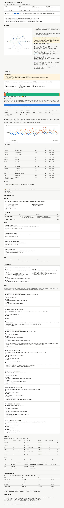
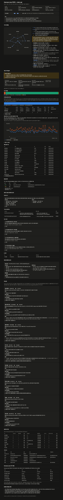

# Harness Lens

> 하네스를 바꾸기 전에, 무엇을 얻고 무엇을 잃는지 근거와 함께 본다.

Harness Lens는 AI 코딩 에이전트 하네스(Hooks, Skills, MCP, Subagents, 권한 규칙, CI·Git Hook 설정 등)의 구성과 변경을 **읽기 전용**으로 분석해, 기대 효과와 잠재적 손실을 근거와 함께 로컬 HTML 리포트로 보여주는 오픈소스 Agent Skill이다. 최적화 방향은 사람이 결정하고, Harness Lens는 판단 근거를 제공한다.

**English summary.** Harness Lens is an open-source Agent Skill for Claude Code that reads your agent harness (hooks, skills, MCP servers, subagents, permission rules, CI and Git hook configs) without modifying it, and produces an offline HTML report of the trade-offs in your current setup and in each change, with evidence for every claim. It computes no overall score, runs no background process, sends nothing to any server of its own, and aggregates local Claude Code session logs as numbers only. Note that the interpreting LLM is your own agent's model: if it is a cloud model, the compact inventory and any original config files it opens during interpretation reach that provider. Status: alpha, Claude Code only, Korean UI, MIT License.

## 상태

**alpha (엔진 v0.4.0, 루브릭 0.4, 스키마 0.1).** MVP 1 범위가 동작한다: 정적 구성 분석, 스냅샷 비교, 오프라인 HTML 리포트, Claude Code 세션 기록 실측 집계(FR-10), 근거 성숙도 표시(FR-11). 규격과 리포트는 아직 자주 바뀐다. 공개 배포(마켓플레이스 등록) 전이라 아래 설치 명령의 `<owner>/<repo>`는 자리표시다.

## 무엇을 보여주는가

- **현재 구성의 트레이드오프** (첫 분석부터): 어떤 축에 투자하고 어떤 축을 내줬는지, 구성 요소별 득실(예: 리뷰 서브에이전트 → 결함 탐지 ↑, 호출·대기 ↑), 근거가 있는 축 간 긴장(자율성↔검증 게이트 등), 미구성·미확인 영역.
- **변경 트레이드오프** (이전 스냅샷이 있을 때): 추가·삭제·수정·미확인 변경과 변화별 기대 효과, 잠재적 손실, 영향 불명 영역, 검증 방법.
- **8개 축의 구조 프로필**: 명세 명확성, 검증 게이트 강도, 실행 안정성, 처리 속도, 비용 효율, 컨텍스트 효율, 자율성, 안전 경계. 수준(0~3)은 LLM이 아니라 엔진이 공개 루브릭의 규칙 ID(예: `VG-L3-01`)로 계산한다.
- **근거**: 모든 판단에 파일 경로·규칙·적용 조건·불확실성이 붙는다. 근거가 없거나 읽지 못한 곳은 0점이 아니라 "미확인"으로 표시한다.

## 하지 않는 것

| 원칙 | 의미 |
|---|---|
| 임의 점수 금지 | 0~100 성능 점수, 단일 종합 점수, 하네스 간 순위를 만들지 않는다. 레이더 면적은 종합 점수가 아니다. 설정이 많다는 이유만으로 수준을 올리지 않는다(서술만으로는 최대 1). |
| Read Only | 분석 대상 파일과 설정을 바꾸지 않는다. 쓰기는 결과 디렉터리에만 한다. 기본값은 `<프로젝트>/.harness-lens/`이고, 사용자가 요청하면 `--out`으로 다른 위치(프로젝트 밖 포함)를 쓸 수 있다. 첫 실행 때 결과 디렉터리에 `.gitignore`(`*`)를 만든다. Hook·MCP 서버·스크립트·`git`을 실행하지 않는다. |
| Local First | 엔진은 네트워크에 접속하지 않고 텔레메트리가 없다. 리포트는 외부 CDN·로그인·서버 없이 브라우저에서 열린다. |
| 상주 프로세스 없음 | 백그라운드 프로세스와 상시 Hook이 0개다. 분석을 요청할 때만 실행된다. 평소 세션에는 Skill 이름·설명(목표 약 100토큰 이하)만 올라간다. |
| 자동 최적화 없음 | 하네스를 자동으로 고치거나 다음 변경을 결정하지 않는다. |

## 설치

두 채널 중 **하나만** 쓴다. 둘 다 설치하면 Skill이 목록에 중복으로 나온다.

<!-- 결정 필요(오너): 공개 저장소 경로(<owner>/<repo>), 플러그인 version 정책(고정 vs 커밋 SHA 추적). -->

### Claude Code 플러그인 (주 채널)

```text
/plugin marketplace add <owner>/<repo>
/plugin install harness-lens@harness-lens
```

- Claude Code v2.1.275 이상이면 한 번에 할 수 있다: `/plugin install harness-lens --marketplace <owner>/<repo>`
- 설치 자체에는 Node.js가 필요 없다. 분석을 실행하는 엔진에는 **Node.js 20 이상**이 필요하다. 별도 의존성 설치는 없다(엔진은 의존성 없는 단일 번들).
- 업데이트: `/plugin` → Installed → Update now. 서드파티 마켓플레이스는 자동 업데이트가 **기본으로 꺼져 있다**. 켜려면 `/plugin` → Marketplaces 탭에서 설정한다.
- 제거: `/plugin uninstall harness-lens@harness-lens`. 분석 결과는 프로젝트의 `.harness-lens/`에 있으므로 플러그인을 지워도 남는다.
- project·local 범위로 설치하면 Claude Code가 대상 저장소의 `.claude/settings*.json`에 플러그인 활성화 키를 병합한다. 이것은 Claude Code의 설치 동작이며 Harness Lens 분석이 쓰는 파일이 아니다.

공개 전 로컬에서 시험하려면 저장소를 클론하고 그 경로로 마켓플레이스를 추가한다: `/plugin marketplace add ./<클론 경로>`.

### `npx skills` (Agent Skills 표준 설치 도구)

```sh
npx skills add <owner>/<repo> --skill harness-analyze -a claude-code
```

- `npx skills` CLI 자체가 **Node.js 22.20 이상**을 요구한다(엔진 하한 20과 별개).
- **덮어쓰기 주의:** 같은 이름(`harness-analyze`)의 스킬 폴더가 이미 있으면 **폴더가 통째로 교체**된다(`-y`면 확인 없이). 기존 스킬이 있으면 `--rename`으로 다른 이름을 준다.
- 기본 범위는 현재 프로젝트이며 `.claude/skills/`(에이전트에 따라 `.agents/skills/`)와 `skills-lock.json`이 생긴다. 사용자 전역은 `-g`.
- `npx skills` CLI는 익명 사용 데이터를 기본으로 수집한다(Harness Lens가 아니라 설치 도구의 동작). 끄려면 `DISABLE_TELEMETRY=1` 또는 `DO_NOT_TRACK=1`을 붙인다.
- 업데이트 `npx skills update`, 제거 `npx skills remove harness-analyze`.
- 현재 지원 에이전트는 Claude Code뿐이다. 다른 에이전트(`-a codex` 등)에도 파일은 복사되지만 호출은 검증하지 않았다(MVP 2).

## 사용법

### 첫 분석

분석할 프로젝트에서 Claude Code에게 자연어로 요청한다.

```text
내 하네스 분석해줘
```

명시적으로 호출하려면 플러그인 설치는 `/harness-lens:harness-analyze`, `npx skills` 설치는 `/harness-analyze`다.

Skill은 다음 순서로 진행한다.

1. 엔진이 Node.js 버전을 확인한다. 20 미만이면 설치 안내 한 줄과 함께 멈춘다(LLM만으로 대신 분석하지 않는다).
2. 엔진이 구성을 읽기 전용으로 수집하고, 비밀정보를 제거하고, 루브릭으로 축별 수준을 계산하고, 세션 기록을 숫자로만 집계해 압축 인벤토리를 만든다(`prepare`).
3. 사용자의 LLM이 압축 인벤토리를 읽고 해석(`interpretation.json`) 하나만 작성한다.
4. 엔진이 해석을 스키마와 근거 참조로 검증하고, 통과하면 스냅샷과 `report.html`을 만들어 브라우저로 연다(`finalize`). 자동으로 열 수 없으면 파일 경로를 알려준다.
5. 에이전트가 주요 트레이드오프를 세 줄 이내로 요약한다.

기본 분석 범위는 **프로젝트**다. 요청에서 다음을 밝히면 반영된다.

- 사용자 전역 설정까지 포함: "전역 설정도 포함해서 분석해줘" → `--scope project_and_user`
- 세션 기록 집계 끄기: "세션 기록은 보지 말고 분석해줘" → `--no-sessions` (`.harness-lens/config.json`의 `"sessions": { "enabled": false }`로 고정할 수도 있다)

### 재분석

하네스를 바꾼 뒤(예: MCP 추가, Hook 수정, 리뷰 에이전트 제거) 같은 요청을 다시 하면 된다. 엔진이 직전 호환 스냅샷과 비교해 리포트에 **변경 내역**과 **변경 트레이드오프**를 더한다. 분석 기준(스키마·루브릭) 버전이 다른 스냅샷과는 비교 제한을 표시한다. 세션 기록은 증분으로 읽는다. 재분석의 **엔진 실행 시간** 목표는 5초 이내이며, LLM이 해석을 쓰는 시간은 여기에 들어가지 않는다.

검증에 실패한 결과는 `.harness-lens/runs/`에만 남고 스냅샷이 되지 않는다. 기존 정상 결과는 그대로다.

### 엔진 직접 실행 (고급)

보통은 Skill이 호출한다. Node.js 20 이상에서 저장소 루트 기준으로:

```sh
E=skills/harness-analyze/scripts/harness-lens.mjs
node $E prepare --project <프로젝트> --json
# → runId와 interpretationPath(기본 <프로젝트>/.harness-lens/runs/<runId>/interpretation.json)를 돌려준다
# 그 interpretationPath에 해석을 쓴다 (형식 예시: examples/interpretations/)
node $E finalize --project <프로젝트> --run <runId> --agent claude-code --json   # 검증 → 스냅샷 → report.html
```

- `--agent`는 해석을 쓴 주체로 `meta.analyzer.agent`에 기록된다. 빼면 `unknown`으로 남는다. Claude Code가 아니라 사람이나 다른 도구가 해석을 썼다면 실제 주체를 적는다.
- `--out`으로 결과 디렉터리를 바꿨다면 `prepare`와 `finalize`에 같은 값을 준다.

서브커맨드·옵션·종료 코드·`.harness-lens/` 구조는 [엔진 CLI 명세](./docs/spec/engine-cli.md)에 있다.

## 리포트 보는 법

리포트는 `.harness-lens/report.html`(최신)과 `.harness-lens/snapshots/<snapshotId>/report.html`(각 시점)이다. 위에서부터:

| 섹션 | 내용 |
|---|---|
| 상단 | 프로젝트, 분석 시점, 스냅샷 ID, 분석 기준 버전, 분석 범위, "실측 n / 전체 축" 성숙도 바 |
| 구조 프로필 | 8개 축 레이더. 이전·현재 프로필을 겹쳐 그리고, 축마다 가능 범위를 반투명 막대로 표시한다 |
| 세션 기록 실측 | 토큰 4종 분리(새 입력·캐시 쓰기·캐시 읽기·출력)와 가격 비중 환산값, 위치별 비중, 턴별 컨텍스트 크기 추이, 귀속 |
| 변경 내역 | 추가·삭제·수정된 구성 요소와 근거 파일 (이전 스냅샷이 있을 때만) |
| 현재 구성의 트레이드오프 | 투자와 포기, 구성 요소별 득실, 축 간 긴장, 빈 영역 |
| 변경 트레이드오프 | 기대 효과 / 잠재적 손실 / 영향 불명 / 검증 방법 (이전 스냅샷이 있을 때만) |
| 축 상세 | 판단 근거, 조건, 반례 가능성, 추가 검증 방법 |
| 상세 수치 표 | 차트와 같은 데이터를 표로 (정확한 비교·접근성용) |
| Harness Lens 자기 비용 | 상시 컨텍스트 토큰, 직전 분석의 토큰·시간 |
| 한계와 미확인 영역 | 읽지 못한 출처, 지원하지 않는 항목, 집계 한계 |

상태는 색만이 아니라 텍스트와 선 스타일로 구분한다. 다크 모드를 지원한다.

### 샘플 화면

> **합성 데이터다.** 아래 화면은 가상의 샘플 프로젝트 [`examples/sample-project`](./examples/sample-project/)(todo-api)와 고정 시드로 만든 가짜 세션 기록으로 엔진을 실제로 돌려 만든 리포트다. 실제 사용자의 설정·대화·경로는 들어 있지 않다.

시나리오: 권한 규칙·Bash 차단 Hook·릴리스 점검 Skill이 있던 구성에 **종료 전 검증 Stop Hook**을 더한 뒤 재분석했다. 리포트는 검증 게이트·실행 안정성이 2→3으로 오른 대신, 같은 기간 합성 세션의 턴 시간 중앙값이 약 40초→90초로 늘어 처리 속도 실측 대역이 2→1로 내려간 트레이드오프를 보여준다(상관관계, 시연용 설계 값).

| 라이트 (1200px) | 다크 (1200px) | 휴대폰 폭 (390px) |
|---|---|---|
| [](./docs/images/sample-report-light.png) | [](./docs/images/sample-report-dark.png) | [](./docs/images/sample-report-mobile.png) |

이미지는 전체 페이지라 길다. 눌러서 원본 크기로 본다. 다시 만드는 방법은 [샘플 프로젝트 README](./examples/sample-project/README.md)에 있다. 테스트 픽스처로 만든 이전 화면(세션 기록이 없을 때 등)은 [`docs/screenshots/`](./docs/screenshots/)에 있다.

## 근거 성숙도: 예측과 실측

리포트의 모든 축은 둘 중 하나다.

- **예측(구조 수준)**: 설정 파일에서 관찰한 사실을 루브릭에 대어 계산한 0~3 순서형 수준이다. 0 미구성 / 1 서술(지침 문장) / 2 절차(Skill·Agent·CI·Git Hook 명령) / 3 하네스 강제(차단 Hook, 활성 Git Hook의 실패 종료 표지, 권한 규칙, 관리형 설정, sandbox 등). 축별 예외가 있다: 안전 경계는 Hook·권한 규칙이 2이고 sandbox·관리형 설정·`disableBypassPermissionsMode`만 3이며, 처리 속도는 3을 비워 두고 0~2만 쓴다. **실제 성능 측정이 아니다.** 레이더에는 점선과 빈 원으로 그린다.
- **실측(대역)**: Claude Code 세션 기록에서 집계한 지표를 0~3 대역으로 옮긴 값이다. 실선과 채운 점으로 그리고, 같은 구성에서 계산한 구조 수준을 흐리게 겹쳐 차이를 보여준다(과거 예측의 적중 여부를 보여주는 그래프가 아니다. 이전 스냅샷의 수준은 별도 표지로 그린다). 변은 양 끝 축이 모두 실측일 때만 실선이다.

현재 구성이 시작된 뒤(`configSince`)의 표본이 요구량에 닿으면 실측으로 바뀐다. 예측 축에는 "실측까지: 세션 20회 · 40%"처럼 필요한 데이터와 진행도가 붙는다.

| 축 | 실측 전환 | 요구량 (휴리스틱) |
|---|---|---|
| 처리 속도 | 가능 | 세션 20회 |
| 컨텍스트 효율 | 가능 | 세션 20회 |
| 자율성 | 가능 | 도구 호출 500회 |
| 실행 안정성 | 가능 | Bash를 뺀 도구 호출 500회 |
| 비용 효율 | 예측 유지 | 대역 지표(성공 작업당 비용 등)가 정해질 때까지 |
| 명세 명확성 · 검증 게이트 강도 | 예측 유지 | CI·테스트 실행 결과와 PR 리뷰·검사 결과 필요(MVP 3) |
| 안전 경계 | 예측 유지 | 권한 거부 기록 형식 확인 필요 |

- 요구량과 대역 임계값은 모두 경험칙이며 공개하고 실측으로 보정한다. 규칙 전문은 [평가 루브릭](./skills/harness-analyze/references/evaluation-rubric.md)에 있다.
- CI·Git Hook **설정**은 구조적 근거일 뿐 실행 성공률이나 요구사항 충족률이 아니다.
- 구성 변경과 지표 변화의 관계는 상관관계로만 표시하고 인과를 주장하지 않는다. 한 번에 여러 구성 요소가 바뀌면 개별 효과를 확정하지 않는다.
- 세션 기록이 없거나 읽을 수 없으면 축은 예측으로 남고 그 사유를 표시한다.

## 개인정보와 원문 비전송

- **세션 기록**(`$CLAUDE_CONFIG_DIR/projects` 또는 `~/.claude/projects`)은 엔진이 로컬에서 허용 목록 필드의 **숫자만** 집계한다. 대화·코드 원문은 스냅샷·리포트·LLM 입력 어디에도 들어가지 않는다. 집계값은 `.harness-lens/sessions/`에 누적돼 원본 기록이 정리된 뒤에도 추이를 유지한다.
- **세션 귀속**: 기록의 `cwd`로 이 프로젝트(워크트리 포함)의 세션만 합산한다. 다른 프로젝트의 사용량은 리포트에 싣지 않고 제외한 세션 수만 보고한다. 귀속이 불확실한 세션은 "미귀속"으로 따로 표시한다. 경로는 출력에 해시로만 남긴다.
- **비밀정보 제거**: API 키, 토큰, 환경 변수 값, MCP 인증 헤더 등은 수집 직후와 출력 직전 두 번 제거한다. 제거한 종류와 개수만 남기고 값은 남기지 않는다.
- **자체 전송 없음**: Harness Lens는 자체 서버가 없고 엔진은 네트워크에 접속하지 않는다. 단, 해석은 **사용자 에이전트의 LLM**이 쓴다. 클라우드 LLM을 쓰면 다음이 그 제공자(사용자의 기존 LLM 서비스)에게 전달된다. 첫 분석 때 이 사실을 한 번 알린다. LLM 사용량 한도와 비용은 사용자의 기존 서비스 기준이 적용된다.
  - **압축 인벤토리**: 구조 사실·짧은 발췌·집계 수치. 엔진이 비밀정보를 제거한 뒤 만든다.
  - **LLM이 직접 여는 원본 설정 파일**: 분석 프로토콜은 finding 하나를 쓰는 데 꼭 필요할 때 LLM이 원본 파일을 열도록 허용한다. 수집 때 읽은(`status: "read"`) 경로만, 한 분석에 최대 5개까지이고, 민감 파일로 건너뛴 경로(`skipped_sensitive`)와 범위 밖 경로는 열지 않는다. 이 경우 LLM은 엔진을 거치지 않고 파일을 그대로 읽으므로 **엔진의 비밀정보 제거가 적용되지 않는다.** 예를 들어 `.claude/settings.json`이나 `.mcp.json`의 `env`·인증 헤더 값이 파일에 그대로 적혀 있으면 그 원문이 모델에 전달될 수 있다. 비밀값은 설정 파일에 직접 쓰지 말고 환경 변수 참조로 두기를 권한다.
  - 세션 기록 원문은 여기에 해당하지 않는다. 프로토콜은 LLM이 세션 기록 파일을 여는 것을 금지하고 엔진 집계만 쓴다.
- **프롬프트 인젝션 방어**: 분석 대상 파일의 문장은 데이터로만 다룬다. 분석 도구를 겨냥한 지시문을 발견하면 따르지 않고 finding으로 기록한다.
- 결과 디렉터리의 `.gitignore`(`*`)는 새 결과 파일이 일반적인 `git add`에 섞이지 않게 막는다. 이미 Git이 추적 중인 파일이나 `git add -f`로 강제 추가한 파일은 막지 못한다. 결과를 공유하려면 이 `.gitignore`를 직접 지운다.

## 한계

- **MVP 1 범위**다. 수집 대상은 프로젝트 지침(`CLAUDE.md`·`@import`), Claude Code 설정·Hooks·Skills·Agents·MCP, CI 설정(GitHub Actions·GitLab CI·CircleCI·Azure Pipelines·Jenkinsfile), Git hooks(`.husky/`·`.githooks/`·`.git/hooks/`·`.pre-commit-config.yaml`)다. 상세 경로와 읽기 경계는 [엔진 CLI 명세 §6](./docs/spec/engine-cli.md#6-수집-대상과-읽기-경계).
- **플러그인은 이름만 식별한다.** 설정의 `enabledPlugins`에서 활성화된 플러그인 이름만 구성 요소로 남기고, 플러그인 매니페스트·skills·agents·hooks 등 내부 구조는 읽지 않는다. 리포트 한계에 `plugin_contents_not_collected`로 표시된다. 따라서 플러그인이 더하는 Hook·Skill은 축 수준에 반영되지 않는다.
- **Claude Code만 지원**한다. Codex 등 다른 에이전트 어댑터는 MVP 2다.
- **Windows 실기기 미확인.** 엔진은 win32를 허용하지만 실기기에서 검증하지 않았다. Windows에서는 Git Hook 실행 비트를 추정하지 않으며(`git_hook_executable_unconfirmed`), `npx skills`의 symlink 동작도 확인하지 않았다. CI는 Linux(Node 20·22)와 macOS·Windows(Node 22)에서 테스트를 돌리지만, 이것은 CI 러너에서의 테스트이며 실사용 환경 검증을 대신하지 않는다.
- 정적 분석은 설정이 실제로 실행될 때의 효과를 보장하지 않는다. 차단 Hook 판정도 문자열 탐지다.
- 세션 기록 형식은 Claude Code의 공식 계약이 아니다. 형식이 바뀌면 일부 지표가 빠지고 사유가 표시된다.
- 프로젝트·전역 설정의 실제 유효 설정 병합은 확정하지 않는다. `project` 범위에서 수집하지 않은 사용자 설정이 있으면 해당 축의 가능 범위를 넓혀 표시한다.
- LLM 해석은 모델에 따라 달라질 수 있다. 수집·해시·수준·비교는 엔진이 결정론적으로 계산한다.
- 리포트와 해석은 한국어다.

## 로드맵

| 단계 | 범위 |
|---|---|
| **MVP 1** (현재) | Claude Code Skill, CI·Git Hook 설정을 포함한 정적 분석, 스냅샷 비교, 세션 기록 실측 집계, 근거 성숙도, 레이더·HTML 리포트 |
| MVP 2 | Codex 등 추가 어댑터, 분석 규칙·호환성 강화 |
| MVP 3 | 세션 기록 외 실측 소스(CI·테스트 실행 결과, PR 리뷰·필수 검사 결과)와 다른 에이전트 실행 기록 연동. 명세 명확성·검증 게이트 강도까지 실측 비교 |
| MVP 4 | 동일 작업 반복 벤치마킹, 통계 비교, 파레토 분석 |
| MVP 5 | 변경 전 영향 예측과 검증(오차 보고 포함) |

자동 하네스 수정은 로드맵의 목표가 아니다. 후속 범위는 피드백과 연구 결과에 따라 조정한다. 세부는 [PRD](./harness-lens-prd.md) §12.

## 기여

기여를 환영한다. 큰 변경은 PR 전에 이슈로 먼저 논의한다. 자세한 원칙은 [CONTRIBUTING.md](./CONTRIBUTING.md).

- 기여 대상: 분석 규칙과 루브릭, 지식 베이스 항목과 연구 근거(출처 URL·확인일·근거 수준 포함), 익명화된 재현 실험, 수집 어댑터, 리포트 개선
- 테스트: `node --test tests/*.test.mjs` (의존성 없음, Node 20 이상)
- 엔진 소스(`engine/src`)를 고치면 `cd engine && npm ci && npm run build`로 번들을 다시 만들어 함께 커밋한다. CI가 커밋된 번들과 새 빌드를 바이트 단위로 비교한다.
- 비밀정보와 대화·코드 원문을 이슈·픽스처·결과물에 넣지 않는다. 문서는 한국어로 쓴다.
- 피드백은 GitHub 이슈로 받는다. 강제 텔레메트리는 없다.

## 문서

- 제품 요구사항: [harness-lens-prd.md](./harness-lens-prd.md)
- 결과 스키마: [analysis.schema.json](./skills/harness-analyze/schemas/analysis.schema.json) (예시: [examples/analysis.example.json](./examples/analysis.example.json))
- 평가 루브릭: [evaluation-rubric.md](./skills/harness-analyze/references/evaluation-rubric.md)
- 분석 프로토콜: [analysis-protocol.md](./skills/harness-analyze/references/analysis-protocol.md)
- 엔진 CLI: [docs/spec/engine-cli.md](./docs/spec/engine-cli.md)
- 조사: [설치·배포](./docs/research/01-install-distribution.md) · [세션 기록](./docs/research/02-session-logs.md) · [평가 축](./docs/research/03-evaluation-axes.md)

## 저장소 구조

| 경로 | 내용 |
|---|---|
| `.claude-plugin/` | Claude Code 플러그인·마켓플레이스 메타데이터 |
| `skills/harness-analyze/` | 배포 단위 Skill. 엔진 번들(`scripts/`), 스키마, 참고 문서, 리포트 템플릿 포함 |
| `engine/` | 엔진 소스(Node.js 20 이상, ESM, 런타임 의존성 없음). `npm run build`로 단일 번들 생성(esbuild, 개발 의존성) |
| `tests/` | e2e·결정론·보안·검증·성능 예산 테스트. 커밋된 번들을 실행한다 |
| `examples/` | 픽스처(before·after·비밀정보·악성 지시문·합성 세션 기록), 예시 해석, 스키마 예시, README 스크린샷용 합성 샘플 프로젝트(`sample-project/`) |

## 라이선스

[MIT License](./LICENSE).
