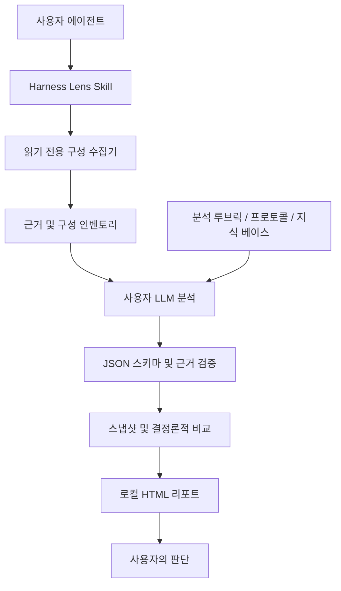

# Harness Lens — Product Requirements Document

- 버전: v0.2 (초안)
- 작성일: 2026-11-27
- 프로젝트명: Harness Lens (가칭)
- 배포 형태: 무료 오픈소스 Agent Skill(Claude Code 플러그인으로 배포) + 로컬 HTML 리포트
- 초기 지원 대상: Claude Code (Codex는 후속 지원)

## 1. 배경 및 문제 정의

AI 하네스 생태계에서 Hooks, Skills, MCP, Subagents, 모델 라우팅, 독립 검증, 컨텍스트 관리 등 다양한 기술이 빠르게 등장하고 있다. 개발자는 새로운 기술을 도입하거나 제거하지만, 그 변경이 자신의 환경에서 어떤 효과와 손실을 가져오는지 파악하기 어렵다.

기존 관측 도구는 실행 로그와 비용을, 벤치마크 도구는 실험 성과를, 최적화 도구는 유망한 설정을 주로 보여준다. Harness Lens는 하네스의 구조와 변경 영향을 사람이 이해할 수 있도록 설명하는 데 집중한다. 이 문제에 대한 실제 사용자 수요와 채택 가능성은 초기 공개 이후 검증한다.

## 2. 제품 비전

> 최적화 방향은 사람이 결정하고, 프로그램은 판단에 필요한 근거를 제공한다.

하네스의 구성과 변경에 따른 잠재적 트레이드오프를 분석하고, 이전 구성과 현재 구성을 직관적으로 시각화하는 오픈소스 분석 프레임워크를 제공한다. 사용자가 보유한 LLM이 표준 분석 절차를 수행하며, 프로젝트는 자체 LLM이나 유료 서버를 운영하지 않는다.

### 2.1 목표

- 현재 하네스가 어떤 목적과 설계 특성을 가지고 있는지 이해한다.
- 기술의 추가·제거·수정으로 기대되는 효과와 잠재적 손실을 함께 확인한다.
- 동일한 기준으로 이전 분석과 현재 분석을 비교한다.
- 레이더 차트, 근거, 불확실성, 상세 지표를 통해 인간의 판단을 돕는다.
- 설치와 사용을 기존 에이전트 Skill 수준으로 단순하게 유지한다.
- 분석 방법론과 연구 지식을 공개하고 커뮤니티 기여를 가능하게 한다.

### 2.2 비목표

- 수익화, 회원가입, 결제, 중앙 서버 운영
- 사용자 하네스의 자동 수정 또는 최적화 결정
- 하네스 간 절대 순위 또는 단일 종합 점수 산출
- 정적 설정만으로 실제 성능이나 비용 절감률을 확정
- 모든 에이전트와 모든 하네스 형식을 MVP에서 지원

## 3. 대상 사용자 및 핵심 사용 사례

대상은 Claude Code 등 코딩 에이전트로 자신의 개발 하네스를 구성하는 개발자, 하네스 엔지니어링을 학습하는 사용자, 여러 구성의 효과를 검증하려는 팀이다.

- 처음 분석: 현재 구성과 설계 의도, 강점, 위험, 미확인 영역을 확인한다.
- 변경 분석: MCP 추가, Hook 수정, 리뷰 에이전트 제거 등 변경 전후의 잠재적 영향을 확인한다.
- 반복 개선: 분석 결과를 보존하고 변경 이력을 비교해 유지·제거·추가 여부를 스스로 판단한다.

## 4. 제품 원칙

| 원칙 | 요구사항 |
|---|---|
| Open Source | 소스, 분석 규격, 평가 기준과 근거를 공개한다. 라이선스는 출시 전 확정한다. |
| Bring Your Own LLM | 사용자 에이전트의 기존 인증 및 사용량을 이용한다. 별도 API 키 발급을 요구하지 않는다. |
| Local First | 분석 자료와 리포트를 로컬에서 관리한다. 자체 외부 전송 및 텔레메트리는 기본적으로 없다. |
| Easy Installation | 한 줄 설치와 한 번의 분석 요청을 지향한다. |
| Read Only | 분석 대상 파일이나 설정을 변경하지 않는다. 결과 전용 디렉터리에만 기록한다. |
| Evidence Based | 분석마다 근거, 적용 조건, 불확실성을 표시한다. |
| Human in Control | 사용자의 용도와 우선순위를 존중하며 자동 결정을 강제하지 않는다. |
| Agent Agnostic | 분석 규격은 에이전트와 분리하고 수집 어댑터만 교체할 수 있게 한다. |

## 5. 사용자 경험

아래 명령은 목표 UX를 설명하기 위한 예시이며 현재 배포된 명령이 아니다. 자체 설치 프로그램은 만들지 않고 기존 배포 채널을 사용한다.

Claude Code (주 채널, 플러그인 마켓플레이스):

```text
/plugin marketplace add <owner>/harness-lens
/plugin install harness-lens@harness-lens
```

기타 에이전트 (Agent Skills 표준 설치 도구):

```sh
npx skills add <owner>/harness-lens -a codex
```

분석 요청: "내 하네스 분석해줘"처럼 자연어로 요청하면 Skill이 호출된다. 명시적 호출은 `/harness-lens:harness-analyze`를 보조로 제공한다.

1. 배포 채널(플러그인 마켓플레이스 또는 `npx skills add`)이 Skill과 엔진 번들을 설치한다. 설치·업데이트·제거와 프로젝트/사용자 범위 선택은 채널이 담당하며 기존 파일을 덮어쓰지 않는다.
2. 분석 시작 시 엔진이 Node.js 20 이상을 확인한다. 없으면 설치 안내 한 줄과 함께 중단한다.
3. 사용자는 현재 프로젝트에서 분석을 요청한다. 기본 분석 범위는 프로젝트이며 전역 설정은 명시적 선택으로 포함한다.
4. 수집기가 읽기 전용으로 지원되는 구성 요소를 식별하고 민감 정보를 제거한다.
5. 사용자 LLM이 평가 기준과 지식 베이스에 따라 분석 결과를 작성한다.
6. 검증기가 결과 스키마 및 근거 참조를 확인한다.
7. 스냅샷과 독립 실행형 HTML 리포트를 생성하고 브라우저로 연다. 자동 열기가 불가능하면 파일 경로를 제공한다. 에이전트의 마지막 응답에 주요 변경과 트레이드오프를 세 줄 이내로 요약한다.
8. 이전 호환 스냅샷이 있다면 비교 결과를 함께 표시한다.

정확한 명령어와 설치 경로는 Claude Code 플러그인 문서 및 Agent Skills 표준을 확인하며 구현 단계에서 확정한다. GUI는 브라우저만으로 열 수 있고 별도 서버가 없어야 한다. 사용자의 기존 LLM 호출에는 해당 서비스의 사용량 한도 또는 비용이 적용된다.

## 6. MVP 1 기능 요구사항

| ID | 기능 | 수용 기준 |
|---|---|---|
| FR-01 | 설치·배포 | Claude Code 플러그인 마켓플레이스와 `npx skills add`로 설치·업데이트·제거할 수 있다. 자체 설치 프로그램 없이 두 채널의 기능을 사용한다. 설치 후 별도 의존성 설치가 필요 없고(Node.js 20 이상 전제), 충돌 시 기존 파일을 보존한다. |
| FR-02 | 구성 수집 | 프로젝트 지침, Hooks, Skills, MCP, Agents, 실행 및 검증 정책을 지원 범위 내에서 식별한다. 읽지 못한 항목과 지원하지 않는 항목을 보고한다. |
| FR-03 | 구조 분석 | 각 구성 요소의 역할, 설계 의도, 의존 관계, 잠재적 효과 및 위험을 근거와 함께 반환한다. |
| FR-04 | 표준 결과 | 분석 JSON이 버전 명시된 스키마를 통과한다. 잘못된 결과는 오류로 표시하며 정상 결과로 저장하지 않는다. |
| FR-05 | 스냅샷 | 분석 시점, 구성 해시, 분석 기준 버전, 모델 정보(확인 가능할 때)를 저장한다. |
| FR-06 | 변경 비교 | 추가·삭제·수정·미확인 변경을 구분하고 이전 분석과 비교한다. 기준이 다른 결과는 비교 제한을 표시한다. |
| FR-07 | 트레이드오프 | (a) 현재 구성의 트레이드오프: 이전 스냅샷 없이도 축별 투자·포기 영역, 구성 요소별 득실, 충돌하기 쉬운 축 조합, 미구성·미확인 영역을 근거와 함께 제시한다. (b) 변경 트레이드오프: 이전 스냅샷이 있으면 변화별 기대 효과, 잠재적 손실, 영향 불명 영역, 검증 방법을 추가로 제시한다. 다음 변경 후보 제안은 MVP 5 범위다. |
| FR-08 | HTML 리포트 | 오프라인 브라우저에서 레이더 차트, 변경 내역, 근거, 불확실성 및 상세 표를 확인할 수 있다. |
| FR-09 | 안전한 실패 | 분석 중 오류가 발생해도 하네스와 기존 정상 결과를 훼손하지 않는다. |
| FR-10 | 세션 기록 실측 집계 | 엔진이 Claude Code 세션 기록(`~/.claude/projects/*.jsonl`)을 로컬에서 읽어 집계 지표만 계산한다. 집계 범위와 지표는 6.1을 따른다. 원문은 저장하지 않고 LLM에 전달하지 않는다. 분석마다 집계값을 `.harness-lens/`에 누적 보존해 원본 기록이 정리된 뒤에도 추이를 유지한다. 기록이 없거나 읽을 수 없으면 해당 축을 예측으로 유지하고 그 사유를 표시한다. |
| FR-11 | 근거 성숙도 표시 | 축마다 예측/실측 상태, 가능 범위, 실측 전환까지 필요한 데이터와 진행도를 표시한다. 실측으로 전환된 축은 이전 예측과의 차이를 함께 보여준다. |

### 6.1 토큰 집계 범위 (FR-10)

- **포함 대상:** 프로젝트 세션, 워커 워크스페이스 세션, 서브에이전트, 그 프로젝트를 지휘하는 오케스트레이터 봇 채팅(예: Orca 봇 홈 `~/.orca/bots/<봇>/` 아래 기록).
- **귀속 규칙:** 봇 채팅은 프로젝트 경로를 다룬 세션만 해당 프로젝트에 귀속한다. 귀속이 불확실하면 "미귀속"으로 따로 표시하고 합계에 섞지 않는다.
- **지표:** 새 입력, 캐시 쓰기, 캐시 읽기, 출력 토큰을 분리하고 가격 비중을 반영한 환산값을 함께 제공한다. 턴별 컨텍스트 크기 추이와 위치별(봇 채팅·워커·서브에이전트) 비중을 보여준다.
- **중복 제거:** 메시지 ID 기준으로 같은 응답이 여러 줄에 기록된 경우를 한 번만 센다.
- 가격 비중은 공개 가격표 기준 상대값이며 실제 청구액으로 표시하지 않는다.

## 7. 분석 모델 및 평가 기준

### 7.1 초기 평가 축 (가설)

모든 축은 높을수록 해당 특성에 유리하도록 표현하되, 축의 정의와 기준을 고정하고 공개한다.

| 축 | 관찰 가능한 구조적 근거 | 향후 실측 예시 |
|---|---|---|
| 품질 | 요구사항 명세, 수용 기준, 테스트 정책 | 요구사항 충족률, 결함률 |
| 검증 신뢰성 | 독립 리뷰, 승인 게이트, 검증 절차 | 결함 탐지율, 잘못된 승인율 |
| 실행 안정성 | 오류 처리, 재시도 제한, 복구 정책 | 실패율, 복구율 |
| 처리 속도 | 순차·병렬 실행, 대기 및 반복 단계 | 작업 완료 시간 |
| 비용 효율 | 모델 배정, 호출 횟수 제한, 재사용 정책 | 성공 작업당 비용 및 토큰 |
| 컨텍스트 효율 | 정보 전달, 격리, 중복 제거 정책 | 입력 토큰, 중복 데이터량 |
| 자율성 | 자동 진행, 인간 승인 지점, 중단 조건 | 인간 개입 횟수, 자동 완료율 |

품질과 검증 신뢰성 등 상관성이 높은 축의 중복 평가를 피하도록 루브릭을 검증한다. 축 개수와 정의는 초기 연구를 통해 확정한다.

### 7.2 측정과 추정의 분리

- **관찰 사실:** 파일 또는 설정에서 직접 확인된 정보. 파일 경로와 가능한 경우 위치를 포함한다.
- **구조적 추정:** 관찰 사실과 지식 베이스에서 도출한 조건부 영향. 실제 성능 측정이 아니다.
- **실측:** 실행 기록과 평가 실험에서 얻은 수치. MVP 1에서는 세션 기록 집계(FR-10)만 수집하며, 평가 실험은 MVP 4 범위다. 구성 변경과 지표 변화의 관계는 상관관계로만 표시하고 인과를 주장하지 않는다.
- **미확인:** 근거가 부족하거나 접근할 수 없는 정보. 0점으로 대체하지 않는다.

MVP 1에서는 임의의 0~100 성능 점수를 금지한다. 공개 루브릭으로 설명 가능한 경우에만 구조적 지원 수준(예: 미구성·일부 구성·명시적 구성·강제 검증)을 순서형 척도로 표시한다. 이 척도는 실제 성능과 별개이며, 축별 기준이 마련되지 않으면 레이더의 해당 축을 누락 표시하고 정성 분석을 제공한다. 설정이 많다는 이유만으로 높은 점수를 부여하지 않는다.

### 7.3 파레토 원칙

파레토 최적화는 사용자 판단을 돕는 분석 원리이며 자동 최적화 기능을 뜻하지 않는다. 비교 가능한 실제 수치가 확보된 경우에만 결정론적인 코드로 지배 관계를 계산한다. 모든 목표에서 열등하지 않고 적어도 한 목표에서 우수하면 지배한다고 본다. 동률, 미확인, 측정 불확실성은 별도로 처리한다.

MVP 1에서는 변경에 따른 정성적 상충 관계를 설명하며 실제 파레토 최적성을 주장하지 않는다. 정량 데이터가 확보되는 후속 MVP에서 파레토 프런티어를 제공한다. 한 번의 변경에서 여러 구성 요소가 동시에 바뀌면 개별 효과를 확정하지 않는다.

## 8. GUI 요구사항

### 8.1 리포트 화면

- 상단: 프로젝트, 분석 시점, 스냅샷 ID, 분석 기준 버전, 데이터 유형, 분석 범위
- 메인: 동일 척도의 다각형 레이더 차트. 이전/현재 프로필을 겹쳐 표시하고 범례로 구분한다.
- 변경 내역: 추가·삭제·수정된 구성 요소와 근거 파일
- 현재 구성의 트레이드오프 (첫 분석부터 항상 표시)
  - 투자와 포기: 어떤 축에 투자하고 어떤 축을 내줬는지 한 줄 요약과 근거
  - 구성 요소별 득실: 요소마다 얻는 것과 치르는 비용 (예: 리뷰 서브에이전트 → 결함 탐지 ↑, 호출·대기 ↑)
  - 축 간 긴장: 자율성↔검증 게이트, 검증↔속도·비용 등 현재 구성에서 근거가 있는 조합
  - 빈 영역: 미구성 또는 미확인 축과 그 의미
- 변경 트레이드오프 (이전 스냅샷이 있을 때): 기대 효과 / 잠재적 손실 / 영향 불명
- 축 상세: 판단 근거, 조건, 반례 가능성, 추가 검증 방법
- 상세 수치 표: 차트와 동일한 데이터를 제공하여 정확한 비교와 접근성을 보장한다.

실측·추정·미확인 상태는 텍스트 및 선 스타일로 구분한다. 색상만으로 의미를 전달하지 않는다. 레이더의 면적은 종합 점수로 사용하지 않는다. 이전 분석이 없으면 현재 프로필과 현재 구성의 트레이드오프를 보여주고 변경 내역 섹션은 생략한다. 기준 버전이 달라 비교할 수 없는 축은 명확히 표시한다.

근거 성숙도 (FR-11):

- 예측 축은 점선과 빈 원, 실측 축은 실선과 채운 점으로 그린다. 변은 양 끝 축이 모두 실측일 때만 실선이다.
- 축마다 가능 범위를 반투명 막대로 겹쳐 표시한다. 근거가 쌓일수록 범위가 좁아진다.
- 상단에 "실측 n / 전체 축" 성숙도 바를 둔다. 첫 분석에서는 "지금은 구성 기반 예측"임을 한 줄로 밝힌다.
- 예측 축에는 "실측까지: 세션 20회 · 40%"처럼 필요한 데이터와 진행도를 표시한다.
- 실측 지표를 0~3 구조적 지원 척도와 같은 축에 올릴지, 별도 표기할지는 Spec 단계에서 확정한다.

### 8.2 구현 방향

독립 실행형 HTML/CSS/JS 리포트로 시작한다. 외부 CDN, 로그인, 서버 실행 없이 작동하고, 분석 데이터는 안전하게 직렬화하여 HTML에 삽입한다. 필요성이 검증되면 별도 통합 대시보드를 고려한다.

## 9. 시스템 설계



LLM은 의미 해석과 조건부 가설을 담당한다. 구성 해시, 변경 탐지, 데이터 검증, 비교 계산, 차트 생성은 프로그램이 담당한다. 분석 대상 지침은 실행할 명령이 아니라 분석할 데이터로 취급한다.

### 9.1 제안 저장소 구조

```text
harness-lens/
├── .claude-plugin/
│   ├── plugin.json                 # 플러그인 메타데이터
│   └── marketplace.json            # 이 저장소를 마켓플레이스로 등록
├── skills/harness-analyze/         # 배포 단위 (두 채널 공통)
│   ├── SKILL.md                    # 분석 절차와 엔진 호출만 담는 얇은 Skill
│   ├── references/
│   │   ├── analysis-protocol.md
│   │   ├── evaluation-rubric.md
│   │   └── knowledge-base/
│   ├── schemas/analysis.schema.json
│   ├── scripts/harness-lens.mjs    # 엔진 번들 (빌드 산출물, 의존성 없음)
│   └── assets/report-template.html
├── engine/                         # 엔진 소스: 수집·비밀정보 제거·해시·검증·비교·렌더링
├── tests/
├── examples/
├── README.md
├── CONTRIBUTING.md
└── LICENSE
```

`npx skills add`는 Skill 폴더만 복사하므로 엔진 번들은 반드시 `skills/harness-analyze/` 안에 둔다. 결정론적 작업은 엔진이, 의미 해석은 Skill 절차를 따르는 사용자 LLM이 담당한다.

실행 런타임은 Node.js 20 이상으로 정했다(14.1 참고). 나머지 기술 스택은 최소 의존성, 에이전트 호환성, macOS/Linux/Windows 설치 편의성을 기준으로 선정한다. 결과 파일 위치 예시는 `.harness-lens/`이며 사용자가 공유하지 않는 한 Git 추적에서 제외하도록 안내한다.

### 9.2 결과 데이터 계약 (개념)

```json
{
  "schemaVersion": "0.1",
  "rubricVersion": "0.1",
  "snapshotId": "example-001",
  "analyzedAt": "2026-11-27T00:00:00Z",
  "analysisType": "static",
  "scope": "project",
  "configurationHash": null,
  "analyzer": {"agent": "claude-code", "model": null},
  "evidence": [{"id": "e1", "path": ".claude/settings.json", "description": "검증 Hook 선언 확인"}],
  "findings": [{"axis": "verification_reliability", "status": "inferred", "direction": "potential_positive", "evidenceIds": ["e1"], "condition": "Hook이 실제 실행되고 실패를 차단하는 경우", "confidence": "low", "validation": "실패 테스트로 Hook 동작 확인"}],
  "metrics": [{"axis": "verification_reliability", "kind": "measured", "value": null, "status": "unknown"}],
  "limitations": ["실행 데이터 없음"]
}
```

예시 데이터이며 실제 스키마는 Spec 단계에서 확정한다. 신뢰 수준은 근거의 질을 설명하는 등급이며 통계적 확률로 해석하지 않는다.

## 10. 지식 베이스 및 오픈소스 기여

각 기술 항목은 개념, 적용 조건, 기대 효과, 부작용, 상호작용, 검증 방법, 출처 URL, 발표일, 확인일, 근거 수준, 반례 및 변경 이력을 포함한다. 공식 문서·연구·재현 가능한 실험을 우선하며 커뮤니티 경험담은 별도 등급으로 구분한다.

초기 연구 대상: Hooks, Skills, MCP, Subagents, 독립 리뷰, 검증 루프, Code Mode, 컨텍스트 압축, 병렬 실행, 모델 라우팅. 기술 효과를 보편적 사실로 단정하지 않는다.

기여자는 새로운 분석 규칙, 연구 근거, 익명화된 재현 실험, 어댑터와 리포트 개선을 PR로 제출할 수 있다. 리뷰 기준과 버전 관리 정책을 문서화한다.

## 11. 보안 및 비기능 요구사항

- API 키, 토큰, 환경 변수 값, MCP 인증 헤더 등 비밀정보를 수집 결과와 리포트에서 제거한다. 원문 전송보다 최소 메타데이터 수집을 우선한다. 세션 기록은 엔진이 로컬에서 숫자로만 집계하며, 대화·코드 원문을 스냅샷·리포트·LLM 입력에 포함하지 않는다.
- 프로젝트 파일의 프롬프트 인젝션과 분석 도중 임의 명령 실행을 방지한다. Hook이나 MCP를 실행하지 않고 설정만 검사한다.
- 자체 서버로 데이터를 전송하지 않는다. 단, 사용자 에이전트가 클라우드 LLM을 쓰면 분석 입력이 해당 제공자에게 전달될 수 있음을 명시한다.
- 분석 범위 외 접근, 심볼릭 링크 이탈, 경로 조작을 제한한다. 결과 렌더링 시 HTML/JS 삽입 공격을 방지한다.
- 설치 및 제거는 분석 대상 기존 설정을 보존한다. 분석 실패 시 부분 파일을 정상 스냅샷으로 취급하지 않는다.
- 분석 기준과 스키마 버전, 누락 데이터, 오류를 기록한다. 동일 입력의 결정론적 비교 결과는 재현 가능해야 한다.

### 11.1 성능 예산

Harness Lens 자체가 하네스와 컴퓨터에 주는 부담을 최소화한다. 아래 수치는 초기 목표이며 구현 후 실측으로 보정한다.

| 항목 | 목표 | 방법 |
|---|---|---|
| 평소 세션 컨텍스트 추가량 | 약 100토큰 이하 | Skill 이름·설명만 상시 로드. 본문·루브릭·지식 베이스는 분석 요청 시에만 로드 |
| 백그라운드 프로세스 | 0개 | 상주 프로세스와 상시 Hook 없음. 분석은 사용자 요청 시에만 실행 |
| 재분석 엔진 실행 시간 | 5초 이내 | 세션 기록 증분 처리(파일별 읽은 위치 기록). 최초 분석은 예외로 진행 상황 표시 |
| 엔진 메모리 사용량 | 200MB 이하 | 파일 전체 로드 대신 줄 단위 스트리밍 처리 |
| 분석당 LLM 토큰 | 최소화 (수치는 Spec에서 확정) | 원문 대신 압축 인벤토리·집계값만 전달. 지식 베이스는 존재하는 구성 요소 항목만 선택 |

- **자기 비용 공개:** 리포트에 Harness Lens 자신을 구성 요소로 포함하고, 상시 컨텍스트 토큰과 직전 분석의 토큰·시간을 표시한다.
- 성능 예산 초과는 테스트에서 실패로 처리한다.

## 12. 로드맵

| 단계 | 범위 | 완료 조건 |
|---|---|---|
| MVP 1 | Claude Code Skill, 정적 분석, 스냅샷 비교, 세션 기록 실측 집계, 근거 성숙도 표시, 레이더/HTML 리포트 | 설치부터 첫 분석·재분석까지 로컬에서 완료. 세션 기록이 있는 축은 실측으로 표시 |
| MVP 2 | Codex 등 추가 어댑터, 분석 규칙 및 호환성 강화 | 동일 분석 규격으로 복수 에이전트 결과 생성 |
| MVP 3 | 세션 기록 외 실측 소스 확장(CI·테스트 결과, PR 리뷰 기록 등)과 다른 에이전트의 실행 기록 연동 | 품질·검증 축까지 추정과 실측을 분리해 비교 가능 |
| MVP 4 | 동일 작업 반복 벤치마킹, 통계 비교, 파레토 분석 | 비교 조건과 불확실성을 포함한 프런티어 생성 |
| MVP 5 | 변경 전 영향 예측 및 검증 | 충분한 실험 데이터 기반 예측과 오차 보고 |

자동 하네스 수정은 로드맵의 필수 목표가 아니다. 후속 범위는 사용자 피드백과 연구 결과에 따라 조정한다.

## 13. 검증 계획 및 성공 기준

수익 대신 실제 사용성과 신뢰성을 성공 기준으로 삼는다. 초기 목표는 아래와 같은 제안이며 공개 후 피드백으로 보정한다.

- 신규 사용자가 README만 보고 설치 및 첫 분석을 완료할 수 있다.
- 동일 구성의 반복 분석에서 수집·해시·변경 비교 결과가 일치한다. LLM 해석의 편차는 별도로 평가한다.
- 구성 요소를 의도적으로 추가·삭제한 테스트 픽스처에서 변경을 올바르게 탐지한다.
- 근거가 없거나 접근 불가능한 경우 추정하지 않고 미확인으로 표시한다.
- 정상/오류/비밀정보 포함/악성 지침 포함 픽스처로 검증 및 안전성을 테스트한다.
- 네트워크를 차단한 브라우저에서도 리포트를 열고 비교 데이터를 확인할 수 있다.
- 실제 외부 사용자에게 레이더 차트와 설명을 보여주고 무엇이 바뀌었고 어떤 손실이 예상되는지 이해할 수 있는지 확인한다. 자발적 피드백 및 GitHub 이슈를 활용하며 강제 텔레메트리는 사용하지 않는다.

## 14. 결정 사항, 미결정 사항 및 리스크

### 14.1 결정 사항

- **실행 런타임: Node.js 20 이상** (2026-11-27 결정). 결정론적 엔진(수집·비밀정보 제거·해시·스키마 검증·비교·HTML 생성)은 외부 의존성 없는 단일 번들 파일로 배포한다. 개발 시 라이브러리 사용은 허용하되 배포 전에 번들링한다.
  - 근거: 하네스 설계자는 `npx` 기반 MCP 서버 사용 등으로 Node 보유 가능성이 높다. 크로스 에이전트 설치 도구(`npx skills add`)도 Node를 전제로 한다. HTML/JS 리포트와 같은 언어를 쓴다.
  - 분석 시작 시 Node 존재와 버전을 확인한다. 조건을 만족하지 않으면 LLM만으로 대체 분석하지 않고, 설치 안내 한 줄과 함께 중단한다(결정론적 비교 보장).
  - Python 전용 사용자 지원은 실제 요청이 있을 때 검토한다.

### 14.2 미결정 사항 및 리스크

- 프로젝트명, 오픈소스 라이선스
- Claude Code 세션 기록 형식은 공식 계약이 아니어서 버전에 따라 바뀔 수 있다. 보존 기간(`cleanupPeriodDays`) 기본값과 파서의 버전 호환 전략을 확인해야 한다.
- Claude Code Skill의 정확한 설치·호출 방법과 지원 OS 범위
- 평가 축 및 순서형 루브릭의 타당성, 모델 간 분석 일관성
- 프로젝트·전역 설정의 병합과 실제 유효 설정 판별 방식
- 정적 분석에서 확인 가능한 사실과 실제 실행 효과 사이의 간극
- 사용자 LLM의 사용량 한도, 파일 접근 권한 및 클라우드 전송 범위
- 시장 수요는 아직 직접 검증되지 않았으며, 기존 도구와의 차별성도 지속 조사 필요

## 15. 다음 단계

1. 공식 Agent Skills 및 Claude Code 문서를 기준으로 지원 파일과 설치 방식 검증.
2. 하네스 구성 요소 분류 체계와 평가 축별 관찰 가능한 기준 연구.
3. 최소 분석 프로토콜, JSON Schema, 근거 검증 규칙 작성.
4. 샘플 하네스 두 개와 변경 픽스처로 분석 및 HTML 리포트의 수직 슬라이스 구현.
5. 직접 사용하며 모델 간 편차와 설치 UX 검증 후 공개.

---

이 PRD는 대화에서 합의한 제품 방향을 바탕으로 작성한 초안이다. 구체적인 평가 축, 설치 명령, 저장소 구조, 후속 MVP 순서는 제안이며 구현이나 검증이 완료된 사항이 아니다.
